# Arquitectura de Warehouse Cloud Platform

## 1. Contexto

Warehouse Cloud Platform es una plataforma distribuida
para administrar multiples bodegas independientes.

Cada bodega administra su propio inventario, productos,
movimientos y reservas.

La plataforma central consolida la informacion global
y coordina las transferencias entre bodegas sin acceder
directamente a sus bases de datos.

## 2. Diagrama de arquitectura final

El siguiente diagrama representa la arquitectura objetivo
del proyecto, incluyendo componentes implementados y
componentes pendientes de integracion definitiva.

```mermaid
flowchart TB
    C[Clientes y operadores]

    subgraph W1["WH-001"]
        A1[Warehouse API]
        R1[(Redis)]
        D1[(PostgreSQL)]
        T1[Workers y Outbox]

        A1 <--> R1
        A1 <--> D1
        T1 <--> D1
    end

    subgraph W2["WH-002"]
        N[Nginx]
        A21[API replica 1]
        A22[API replica 2]
        A23[API replica 3]
        R2[(Redis)]
        D2[(PostgreSQL)]
        T2[Workers y Outbox]

        N --> A21
        N --> A22
        N --> A23

        A21 <--> R2
        A22 <--> R2
        A23 <--> R2

        A21 <--> D2
        A22 <--> D2
        A23 <--> D2

        T2 <--> D2
    end

    subgraph W3["WH-003"]
        A3[Warehouse API]
        R3[(Redis)]
        D3[(PostgreSQL)]
        T3[Workers y Outbox]

        A3 <--> R3
        A3 <--> D3
        T3 <--> D3
    end

    MQ[RabbitMQ]

    subgraph CENTRAL["Plataforma central"]
        CA[Central API]
        CD[(PostgreSQL central)]
        P[Worker de proyeccion CQRS]
        S[Orquestador Saga]
        O[Outbox Relay central]
        ST[Temporizador Saga]

        CA <--> CD
        P --> CD
        S <--> CD
        O <--> CD
        ST <--> CD
    end

    C --> A1
    C --> N
    C --> A3
    C --> CA

    T1 <--> MQ
    T2 <--> MQ
    T3 <--> MQ

    MQ --> P
    MQ --> S
    O --> MQ

    CA -. Fanout HTTP .-> A1
    CA -. Fanout HTTP .-> A21
    CA -. Fanout HTTP .-> A3

    subgraph EXT["Extensiones y arquitectura objetivo"]
        B[Batch diario]
        OBJ[(MinIO local / Amazon S3)]
        L[AWS Lambda]
        PR[Prometheus]
        G[Grafana]
        I[Simulador IoT]
        M[Broker MQTT]
        IW[Worker IoT]

        B --> OBJ
        OBJ --> L
        PR --> G
        I --> M
        M --> IW
    end

    B -. Consulta API .-> A1
    B -. Consulta API .-> N
    B -. Consulta API .-> A3
    B -. Registro Batch .-> CA
    PR -. Recoleccion de metricas .-> P
    PR -. Recoleccion de metricas .-> A1
    PR -. Recoleccion de metricas .-> MQ
    IW -. Integracion IoT prevista .-> MQ
```

## 3. Componentes

| Componente | Responsabilidad |
| --- | --- |
| Warehouse API | Gestionar productos, inventario y movimientos locales. |
| PostgreSQL por bodega | Almacenar los datos operacionales de cada dominio. |
| Redis | Reducir consultas repetitivas mediante Cache Aside. |
| Nginx | Distribuir solicitudes entre replicas de WH-002. |
| RabbitMQ | Transportar eventos y comandos asincronos. |
| Transactional Outbox | Persistir eventos junto con los cambios de negocio. |
| Central API | Exponer consultas globales y transferencias. |
| PostgreSQL central | Almacenar el modelo de lectura y el estado de Saga. |
| Worker CQRS | Actualizar la proyeccion del inventario global. |
| Orquestador Saga | Coordinar transferencias y compensaciones. |
| Locust | Ejecutar pruebas de carga y rendimiento. |
| Batch | Generar reportes empresariales. |
| MinIO / S3 | Almacenar reportes y objetos. |
| Lambda | Validar reportes generados en S3. |
| Prometheus | Recolectar metricas. |
| Grafana | Visualizar metricas y comportamiento del sistema. |
| MQTT | Transportar mensajes de dispositivos IoT. |
| Terraform | Automatizar el aprovisionamiento de infraestructura AWS. |

## 4. Comunicacion entre servicios

### 4.1. Comunicacion sincrona

Los clientes utilizan HTTP para consultar o modificar
informacion mediante las APIs.

La plataforma central puede utilizar Fan-out para
consultar las APIs de las bodegas en paralelo.

Las solicitudes HTTP protegidas utilizan X-API-Key.

### 4.2. Comunicacion asincrona

RabbitMQ transporta los eventos y comandos del sistema.

Flujo de un cambio de inventario:

1. La Warehouse API modifica PostgreSQL.
2. El evento se registra en Outbox dentro de la transaccion.
3. El relay publica el evento en RabbitMQ.
4. El worker central consume el evento.
5. PostgreSQL central actualiza el modelo de lectura.
6. La Central API consulta el inventario consolidado.

La consistencia entre la bodega y la central es eventual.

### 4.3. Transferencias distribuidas

Las transferencias son coordinadas mediante Saga
orquestada desde la plataforma central.

El orquestador administra reservas, envios, recepciones,
estados, timeouts y operaciones compensatorias.

La idempotencia evita repetir efectos ante mensajes
duplicados.

No existe una transaccion ACID global entre bodegas.

## 5. Decisiones arquitectonicas

- Una base de datos independiente por bodega.
- Identificacion global de productos mediante SKU.
- Escalamiento horizontal independiente por bodega.
- Redis como cache y no como fuente de verdad.
- RabbitMQ para desacoplar productores y consumidores.
- Transactional Outbox para tolerar fallos del broker.
- CQRS para reducir la dependencia de consultas remotas.
- Saga orquestada para las transferencias distribuidas.
- Logs estructurados y correlation ID para trazabilidad.
- MinIO en desarrollo local y S3 como objetivo cloud.
- Terraform para infraestructura reproducible.

Las decisiones y alternativas se documentan en el
[indice de ADR](adr/README.md).

## 6. Despliegue

### Entorno local

Docker Compose permite ejecutar los servicios de la
plataforma en contenedores.

Cada bodega cuenta con su propia red, base de datos
y cache. RabbitMQ proporciona la comunicacion entre
los dominios.

### Arquitectura objetivo en AWS

- EC2 para ejecutar los servicios.
- ECR para almacenar las imagenes Docker.
- RDS para PostgreSQL.
- S3 para almacenar reportes.
- Lambda para validar objetos.
- Terraform para aprovisionar infraestructura.

La configuracion efectiva y las evidencias del despliegue
deben verificarse antes de declarar AWS validado.

## 7. Estado de integracion

| Fase | Estado documentado |
| --- | --- |
| F1 - API y PostgreSQL | Implementacion existente |
| F2 - Redis | Implementacion y pruebas de carga |
| F3 - RabbitMQ | Implementacion base y Outbox |
| F4 - Multiples bodegas | Configuracion distribuida existente |
| F5 - Balanceo | Nginx y evidencias de escalamiento |
| F6 - Saga | Implementacion en ramas; validacion final pendiente |
| F7 - CQRS | Central base integrada; proyeccion y fanout pendientes de integracion |
| F8 - S3 y Batch | Verificar integracion final |
| F9 - Lambda | Verificar integracion final |
| F10 - Resiliencia | Pruebas preliminares; validacion final pendiente |
| F11 - Observabilidad y carga | Evidencias parciales; informe final pendiente |
| F12 - IoT | Verificar integracion final |

Este documento representa la arquitectura objetivo
y no certifica que todas las fases esten integradas
o desplegadas.

## 8. Referencias

- infrastructure/compose/compose.distributed.yml
- infrastructure/compose/compose.central.yml
- services/central/
- services/warehouse-api/
- docs/events.md
- docs/adr/
- docs/fases/
- docs/load-testing.md

Las referencias correspondientes a ramas pendientes
deben verificarse nuevamente despues de su integracion.
