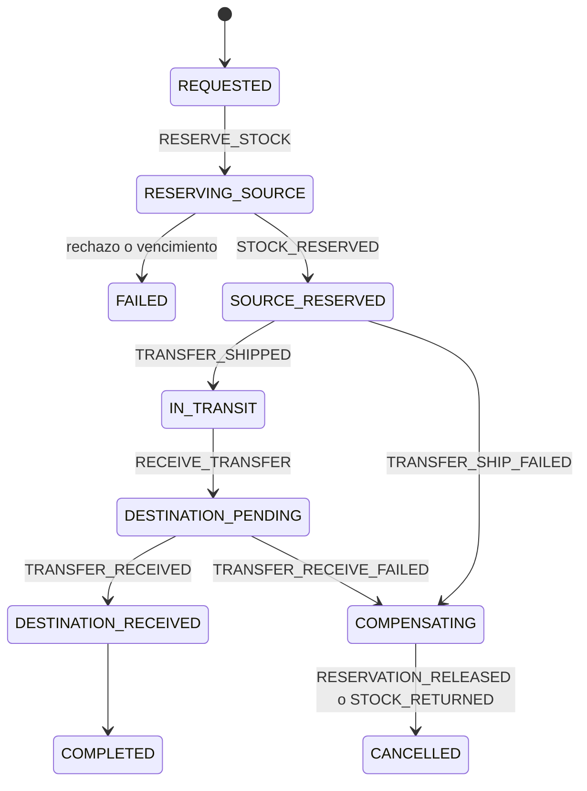

# Fase 6 — Transferencias distribuidas mediante Saga

## E-06: Orquestador central de Saga

### Objetivo

Coordinar transferencias de inventario entre bodegas
independientes mediante una Saga orquestada desde
la plataforma central, sin utilizar una transaccion
distribuida global.

### Componentes implementados

- Maquina de estados de transferencias.
- Persistencia de transferencias e historial en PostgreSQL.
- Central API para solicitar y consultar transferencias.
- Outbox Relay para publicar comandos y eventos.
- Orquestador consumidor de eventos RabbitMQ.
- Temporizador para detectar transferencias vencidas.
- Control de idempotencia mediante processed_messages.
- Logs estructurados y propagacion de correlation ID.

### Endpoints

- POST /transfers
- GET /transfers/{transfer_id}

La creacion de transferencias utiliza Idempotency-Key
para evitar solicitudes duplicadas.

### Flujo exitoso

REQUESTED -> RESERVING_SOURCE -> SOURCE_RESERVED
-> IN_TRANSIT -> DESTINATION_PENDING
-> DESTINATION_RECEIVED -> COMPLETED.

### Manejo de fallos

- Reserva rechazada: estado FAILED.
- Envio rechazado: TRANSFER_SHIP_FAILED lleva a
  COMPENSATING, se ordena RELEASE_RESERVATION y se
  alcanza CANCELLED al recibir RESERVATION_RELEASED.
- Recepcion rechazada: estado COMPENSATING, seguido
  de CANCELLED tras confirmar RETURN_STOCK.
- Reserva sin respuesta durante 30 segundos: FAILED.
- Reserva confirmada fuera del plazo:
  comando RELEASE_RESERVATION.
- Destino sin respuesta durante cinco minutos:
  alerta en logs sin cancelar la transferencia.
- Reinicio del orquestador: recuperacion mediante
  PostgreSQL y mensajes pendientes en RabbitMQ.

### Garantias de consistencia

- Persistencia atomica de estados, historial y Outbox.
- Bloqueo de filas para controlar modificaciones concurrentes.
- Deduplicacion de eventos mediante event_id y consumer.
- Rechazo de transiciones incompatibles.
- Publicacion asincrona de comandos.
- Conservacion del estado ante reinicios.

### Pruebas realizadas

| Escenario | Resultado |
| --- | --- |
| Creacion y consulta de transferencias | Exitoso |
| Idempotencia de solicitudes HTTP | Exitoso |
| Publicacion mediante Outbox | Exitoso |
| Transferencia exitosa simulada | Exitoso |
| Eventos duplicados | Exitoso |
| Eventos incompatibles | Exitoso |
| Reserva rechazada | Exitoso |
| Recepcion rechazada y compensacion | Exitoso |
| Timeout real de reserva | Exitoso |
| Reserva tardia y liberacion | Exitoso |
| Recuperacion tras reiniciar el worker | Exitoso |
| Destino no disponible simulado | Exitoso |
| Alerta de cinco minutos con fecha simulada | Exitoso |
| Pruebas unitarias pytest | 46/46 |
| Transferencia real entre bodegas | Exitoso |
| Rechazo real por stock insuficiente | Exitoso |
| Idempotencia HTTP real | Exitoso |
| Compensacion real por rechazo del destino | Exitoso |
| Compensacion por fallo de envio inducido | Exitoso |

### Cobertura de los seis experimentos del plan

El [registro de integración](../evidencias/fase-6/e06-integracion.md)
documenta el caso 100/20 → 70/50, con 175 unidades totales al
incluir WH-003. Las cinco corridas de ese registro abarcan casos
distintos de los seis experimentos del plan.

| Experimento del plan | Evidencia disponible | Evidencia por completar |
| --- | --- | --- |
| Origen detenido antes de reservar | Timeout de reserva verificado | Historial con la bodega detenida e inventario antes y después |
| Fallo después de reservar | Corrida real con liberación anticipada de la reserva y conservación de 175 unidades | Repetición con la inyección prevista por el plan |
| Destino temporalmente caído | Destino pendiente y alerta verificados con simulación | Historial desde la detención de WH-002 hasta completar la transferencia |
| Comando RabbitMQ duplicado | Eventos duplicados probados e idempotencia HTTP verificada con bodegas reales | Republicación del comando y comprobación de que no repite el movimiento |
| Timeout con confirmación tardía | Timeout y liberación tardía verificados | Historial de la corrida con pausa del consumidor de origen |
| Reinicio del orquestador | Recuperación del worker verificada | Historial de una transferencia real e inventario antes y después |

### Limitaciones y pendientes

Las pruebas funcionales utilizaron bodegas simuladas,
PostgreSQL y RabbitMQ reales en Docker.

La alerta de destino pendiente se verifico modificando
la antiguedad de una transferencia de prueba.

La deduplicacion de alertas se mantiene en memoria
durante cada ejecucion del worker. Un reinicio puede
generar nuevamente una alerta para una transferencia
que siga pendiente.

La integracion con J-07 fue validada localmente con tres
bodegas, PostgreSQL, Redis y RabbitMQ reales en Docker.

Se verificaron cinco escenarios de integracion, incluyendo
la conservacion del inventario y las dos compensaciones.

El fallo de envio se indujo liberando anticipadamente
una reserva mediante el handler real de la bodega.

Evidencias: [integracion E-06](../evidencias/fase-6/e06-integracion.md).

La aprobacion y fusion del PR #56 siguen pendientes.

### Decision arquitectonica

Consultar ADR-0013: Saga orquestada desde la central.

---

## J-07 — Lado bodega: consumidor de comandos

### Qué se hizo

- Worker `workers.commands` en la imagen de bodega, consumiendo `wh-00X.commands`
  (servicio `commands-worker` en el Compose raíz y `wh00X_commands` en el distribuido).
- Migración `002_saga_commands.sql`: tabla `processed_messages(message_id, consumer,
  processed_at)` con PK compuesta y cinco tipos de movimiento de transferencia.
- `RESERVE_STOCK` (respeta `deadline` y disponible), `RELEASE_RESERVATION`,
  `SHIP_TRANSFER`, `RECEIVE_TRANSFER` (falla permanente si el SKU no existe) y
  `RETURN_STOCK`.
- Cada comando: una transacción con `processed_messages` + inventario + movimiento +
  outbox (respuesta e `INVENTORY_UPDATED`); ack después del commit.
- `CHAOS_FAIL_STEP` para fallar antes o después del commit.
- Documentación: sección Bodega de [distributed-transactions.md](../distributed-transactions.md)
  y [ADR-0020](../adr/0020-idempotencia-comandos-bodega.md).

### Evidencia

[evidencias/fase-6/saga-bodega-e2e.md](../evidencias/fase-6/saga-bodega-e2e.md):

- Con la central de E-06, P-001 pasa de 100/20 a **70/50** y la transferencia
  termina `COMPLETED` en ~2 s.
- SKU inexistente en destino → `TRANSFER_RECEIVE_FAILED` → `RETURN_STOCK` →
  `CANCELLED`, y el origen vuelve a su stock inicial.
- `CHAOS_FAIL_STEP=SHIP_TRANSFER:after_commit`: la reentrega se detecta como
  duplicado y el stock se descuenta una sola vez.
- `pytest tests`: 65 pasadas, 5 omitidas (requieren RabbitMQ).

### Preguntas del profesor

**¿Qué pasa si la bodega procesa un comando y se cae antes del ack?**
El efecto y la fila de `processed_messages` ya están confirmados. RabbitMQ reentrega
el mensaje; el `INSERT … ON CONFLICT DO NOTHING` no inserta y el worker hace ack sin
repetir nada. Las respuestas ya están en el outbox, así que también se publican.

**¿Y si se cae antes del commit?**
La transacción se revierte entera (no queda reserva, movimiento, evento ni registro
del mensaje). La reentrega procesa el comando como si fuera la primera vez.

**¿Por qué la reserva no descuenta `quantity`?**
Porque el stock sigue físicamente en la bodega hasta el envío. La reserva solo baja el
disponible (`quantity - reserved_quantity`), que es lo que validan las salidas
normales; así una venta local no puede llevarse unidades comprometidas.

**¿Cómo se evita aplicar dos veces un paso que la central reenvía con otro `event_id`?**
Los movimientos guardan `reference = transfer:<id>`. Con la fila de inventario
bloqueada, el worker revisa si el paso ya existe para esa transferencia; si es así,
solo vuelve a emitir la respuesta (ADR-0020).

### Pendiente

- Resuelto en E-06: la central consume `TRANSFER_SHIP_FAILED`,
  pasa de `SOURCE_RESERVED` a `COMPENSATING` y solicita
  `RELEASE_RESERVATION`. La confirmación lleva a `CANCELLED`.
  Validado mediante integración real con fallo inducido.
- Reintentos con límite y DLQ para comandos inválidos o con error: D-05.
