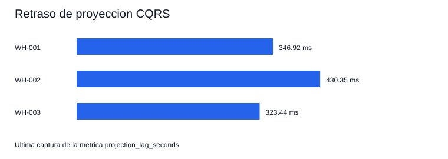

# Fase 7 — Plataforma central y CQRS

## E-03: Estructura de la plataforma central

### Componentes implementados
- Central API con FastAPI y autenticación mediante X-API-Key.
- PostgreSQL independiente con nueve tablas.
- Central Worker preparado para CQRS y Saga.
- Integración de los tres servicios mediante Docker Compose.
- Logs JSON y correlation ID.

### Endpoints implementados
- GET /health
- GET /health/ready
- POST /internal/batch-runs

### Pruebas realizadas
- Docker Compose: configuración válida.
- Central API: HTTP 200 OK.
- PostgreSQL: conexión correcta y tablas creadas.
- Autenticación: HTTP 401 sin API Key.
- Registro Batch: HTTP 201.
- Registro duplicado: HTTP 409.
- Worker: inicio, conexión y reinicio exitosos.

### Pendiente
- E-05: Consultas globales y comparación con fanout.
- E-06: Orquestación Saga.

## E-04: Proyección CQRS y endpoints globales

### Implementación
- Worker central consumidor de RabbitMQ: central.projection.
- Upsert de inventario con control de versión.
- Idempotencia mediante processed_messages.
- Heartbeats y detección stale después de 90 segundos.
- GET /global/warehouses.
- GET /global/inventory/{sku}.
- GET /global/inventory con paginación.
- Métrica projection_lag_seconds expuesta en puerto interno 9101.

### Evidencia
- Proyección de INVENTORY_UPDATED comprobada en PostgreSQL.
- Versiones antiguas descartadas.
- Mismo event_id publicado dos veces y procesado una vez.
- Heartbeat registrado correctamente.
- Endpoint por SKU: HTTP 200, cantidades consolidadas.
- SKU inexistente: HTTP 404.
- Endpoint protegido: HTTP 401 sin API Key.
- Pruebas de paginación y bodega WH-002 pendientes de verificación final.

### Preguntas del profesor
- ¿Por qué CQRS? Para separar el modelo de lectura de las escrituras.
- ¿Qué ocurre si una bodega cae? La consulta sigue respondiendo,
  pero marca como stale los datos de esa bodega.
- ¿Cómo se evitan inconsistencias? Con versiones e idempotencia.

Decisión arquitectónica: [ADR-0012](../adr/0012-proyeccion-cqrs.md).

## E-05: Fan-out y comparacion con CQRS

### Implementacion

- GET /global/inventory/{sku}?mode=fanout.
- Consultas concurrentes mediante httpx.AsyncClient.
- Timeout de 500 ms por bodega.
- CQRS como modo predeterminado.
- Respuestas parciales con identificacion de bodegas no disponibles.
- HTTP 404 para inventario inexistente en todas las bodegas.
- HTTP 503 cuando no se obtiene inventario y hay bodegas no disponibles.
- Integracion multibodega mediante compose.central.yml.
- Pruebas automatizadas de respuestas normales, parciales y errores.

### Experimentos

Se utilizo el SKU P-001 con 20 usuarios concurrentes,
una tasa de inicio de 5 usuarios/s y 45 segundos por escenario.

| Escenario | Solicitudes | Errores | Disponibilidad HTTP | Media (ms) | P95 (ms) | Req/s |
|---|---:|---:|---:|---:|---:|---:|
| CQRS normal | 4289 | 0 | 100% | 93.75 | 200 | 98.52 |
| Fan-out normal | 1854 | 2 | 99.89% | 349.88 | 580 | 42.64 |
| CQRS fallo | 6283 | 0 | 100% | 32.50 | 80 | 144.85 |
| Fan-out fallo | 1386 | 1378 | 0.58% | 513.73 | 530 | 31.27 |

La disponibilidad HTTP corresponde al porcentaje de solicitudes
sin errores registrados por Locust. No garantiza que todas las
respuestas exitosas contengan inventario completo.

### Caida de WH-002

Se detuvieron la API y el worker de WH-002.

CQRS mantuvo las 184 unidades del inventario consolidado
y marco WH-002 como stale.

Fan-out devolvio 161 unidades, partial=true y
unavailable=["WH-002"] en la prueba funcional sin carga.

Durante la prueba concurrente, Fan-out registro 1378
respuestas HTTP 503. El resultado demuestra una degradacion
considerable bajo las condiciones medidas. No se aislo
la causa individual de todos los timeouts o errores.

WH-002 fue restaurada al finalizar los experimentos.

### Comparacion arquitectonica

| Criterio | Fan-out | CQRS |
|---|---|---|
| Latencia normal | 349.88 ms | 93.75 ms |
| Disponibilidad ante fallo | 0.58% bajo carga | 100% |
| Consistencia | Lecturas directas, sin snapshot global atomico | Eventual |
| Complejidad | Agregacion HTTP y control de fallos | Eventos, proyeccion y control de versiones |
| Dependencias de lectura | APIs de las bodegas | PostgreSQL central |

### Retraso de proyeccion

- WH-001: 346.92 ms.
- WH-002: 430.35 ms.
- WH-003: 323.44 ms.

Estos valores corresponden a una captura puntual,
no a un promedio historico.

### Conclusiones

CQRS obtuvo menor latencia y mayor disponibilidad en los
experimentos realizados. Su principal desventaja es la
consistencia eventual y la necesidad de mantener un modelo
de lectura sincronizado.

Fan-out permite consultar directamente las bodegas, pero
depende de su disponibilidad, latencia y capacidad de respuesta.

Se conserva CQRS como mecanismo predeterminado de consulta
global y Fan-out como alternativa experimental.

Los resultados corresponden a una ejecucion local por escenario;
no constituyen garantias de rendimiento en produccion.

### Nota operativa

Durante el arranque inicial, rabbitmq_topology no logro
conectarse a RabbitMQ. Una vez saludable el broker, se recreo
rabbitmq_topology y se inicio central-worker. CQRS recupero
los eventos pendientes y consolido las 184 unidades.

### Evidencias

Los CSV de Locust, respuestas JSON, pruebas automatizadas
y metricas estan en docs/evidencias/fase-7/.
